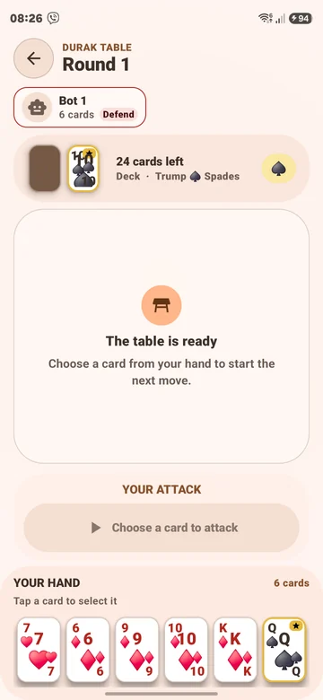
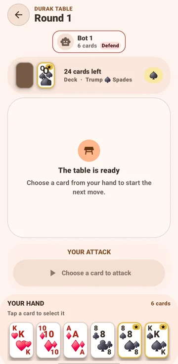
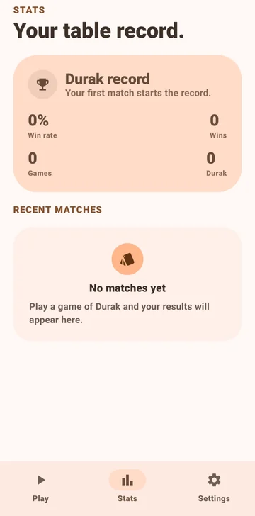

# Card Game Hub

Card Game Hub is a native Android card-game application built with **Kotlin**, **Jetpack Compose**, **Material 3 Expressive**, and **Room**. The current playable experience is an offline, single-player game of **Durak** against local bots. The app is designed around a deterministic game engine and a clear separation between gameplay rules, bot decisions, persistence, and UI.

> **Version 1.1.3 · Build 5**
>
> Current version declared by the Android Gradle configuration.

## Screenshots

The screenshots below are captured from Card Game Hub and show the current home, gameplay, and settings experiences.

| Home | Game table |
|---|---|
|  |  |

| Stats |
|---|
|  |

## Features

| Area | Available in the current build |
|---|---|
| **Offline Durak** | Play a complete local match without an account, server, or network connection. |
| **Local opponents** | Play against classic offline bot opponents with Beginner, Standard, and Expert difficulty levels. |
| **Match configuration** | Choose 2–4 players, a supported 24-, 36-, or 52-card deck, the Standard (Throw-in/Podkidnoy) ruleset, and bot difficulty. Transfer is shown as unavailable until its separate rules are implemented. Four-player tables require at least 36 cards so the trump remains in the draw pile. |
| **Durak rules engine** | Validates attacks, legal defenses, matching-rank throw-ins, the six-card/defender-hand limit, bito clearing, taking the table, participant-only hand replenishment, turn progression, and end-of-match states. |
| **Responsive table** | The opponent rail and central attack/defense pairs adapt to the available screen width. Cards reduce to a readable minimum and the table automatically scrolls when the final pairs cannot fit at once. |
| **Material 3 Expressive UI** | Uses Material theming, expressive shapes, adaptive layout, responsive typography, semantic controls, and official Material 3 list components. |
| **Adaptive color** | Uses Android dynamic color on Android 12 and newer, with warm Material fallback palettes on earlier supported versions. |
| **Navigation appearance** | Choose the standard labeled Material 3 navigation bar or the compact navigation dock from Settings. The choice is saved locally and applied immediately. |
| **Statistics and history** | Completed matches and aggregate statistics are stored locally through Room. |
| **Resume a match** | An in-progress match is saved locally after each transition and restored when the app is reopened. |
| **Safe database upgrades** | Room schema snapshots are exported and explicit migrations preserve existing statistics and match history. |
| **Privacy by default** | The current game is local-only. No sign-in, analytics service, remote matchmaking, or network permission is required for gameplay. |

## Gameplay

Card Game Hub currently focuses on a clean Durak loop: configure the table, deal the cards, attack, defend or take the table, finish the round, replenish hands, and continue until the match reaches its end state. The engine is deterministic and separated from Compose, which makes the rules testable without rendering the UI. The opening attacker is the holder of the lowest trump.

The playable ruleset is **Standard (Podkidnoy/Throw-in) Durak**: the principal attacker leads, and eligible non-defenders may join with cards matching ranks already on the table. The total attack is limited to six cards or the defender's hand size at the start of the bout, whichever is lower. Only players who joined the attack replenish before the defender. The mode picker no longer presents **Classic** as a separate duplicate choice; **Transfer** is a distinct variant and is clearly marked unavailable until its rules are implemented. See [Podkidnoy Durak rules](https://www.pagat.com/beating/podkidnoy_durak.html) for the reference rules used here.

## Design and interaction

The UI follows Material 3 principles while using the expressive component family available in the current Compose dependency line. The home screen uses a prominent split action for starting a match and opening match settings. Settings use segmented list items with leading, supporting, and trailing slots; the mode detail explains the supported rules and marks Transfer unavailable, while the navigation appearance selector changes the real bottom navigation immediately instead of showing a simulated preview.

Back actions use a restrained reverse slide/fade that reveals the actual preceding screen, while lightweight state changes and tactile feedback keep gameplay actions immediate and easy to follow.

## Technical architecture

| Module or package | Responsibility |
|---|---|
| `app/src/main/java/com/example/durak/game` | Deterministic Durak state machine with immutable player/hand snapshots, legal move validation, turn sequencing, and bot-turn recovery. |
| `app/src/main/java/com/example/durak/ai` | Offline bot decision policies for attack, defense, passing, and taking the table. |
| `app/src/main/java/com/example/durak/model` | Cards, suits, players, game modes, difficulties, and validated match configuration. |
| `app/src/main/java/com/example/ui/screens` | Home hub, inline match settings, game table, statistics, history, and settings screens. |
| `app/src/main/java/com/example/ui/viewmodel` | State orchestration between the game engine, Compose UI, and persisted match results. |
| `app/src/main/java/com/example/ui/theme` | Dynamic color, fallback palettes, typography, shapes, and Material 3 theme setup. |
| `app/src/main/java/com/example/data` | Room database entities, exported schemas, explicit migrations, resumable match persistence, history, and transactional statistics. |

The app deliberately keeps future product seams explicit. Additional card games can provide their own rules engine and screen, while online multiplayer can later be introduced behind a dedicated authenticated match service. No future feature is represented as an active online control in the first release.

## Build locally

The repository includes a Gradle wrapper. Use Android Studio or the Android command-line tools with the Android SDK installed, and use the Java toolchain configured by the project.

```bash
./gradlew :app:assembleDebug
```

The debug APK is written to:

```text
app/build/outputs/apk/debug/app-debug.apk
```

To run local tests and build an optimized release APK:

```bash
./gradlew clean :app:testDebugUnitTest :app:assembleDebugAndroidTest :app:assembleRelease --no-daemon --console=plain
```

The release artifact is written to the standard release output directory; Gradle names it `app-release.apk` when signed and `app-release-unsigned.apk` when no private signing values are configured:

```text
app/build/outputs/apk/release/app-release.apk
```

## Tests

Run local unit tests and compile the Compose instrumentation tests with:

```bash
./gradlew :app:testDebugUnitTest :app:assembleDebugAndroidTest
```

Run Compose UI tests on a connected Android device or emulator with:

```bash
./gradlew :app:connectedDebugAndroidTest
```

Run the Durak engine regression suite directly with:

```bash
./gradlew :app:testDebugUnitTest --tests 'com.example.durak.game.DurakEngineTest'
```

The regression coverage includes immutable old-snapshot checks, card hierarchy, legal and illegal defenses, Expert-vs-Standard bot decisions, throw-in behavior, participant-only replenishment, match endings, active-match JSON round trips, and a version 1-to-2 Room migration preserving statistics and history. Compose UI tests cover match setup and a full human-played match. GitHub Actions runs unit tests, builds debug APKs, and runs the UI suite on an Android emulator.

## Release and R8

The current app configuration declares `versionName = "1.1.3"` and `versionCode = 5`. Release builds keep **R8 code shrinking, optimization, obfuscation, and resource shrinking enabled**.

R8 is a build-time optimizer; it is not a runtime feature that older Android devices need to support. The APK runtime floor is defined by `minSdk = 24` (Android 7.0). Therefore, using R8 does not by itself make the app incompatible with older supported Android versions. Release signing is now kept separate from the debug key. To sign a production release, supply `ANDROID_KEYSTORE_PATH`, `ANDROID_KEYSTORE_PASSWORD`, `ANDROID_KEY_ALIAS`, and `ANDROID_KEY_PASSWORD` in the build environment; leave all unset for an unsigned release build. Keep the private keystore and values out of source control. A debug APK is for testing and is signed with the standard debug key.

For more information, see the official Android documentation on [code shrinking](https://developer.android.com/studio/build/shrink-code) and [Java 8+ API desugaring](https://developer.android.com/studio/write/java8-support).

## Project status

Card Game Hub is an active offline card-game app. The current priority is a polished Durak experience with reliable rules, responsive card presentation, adaptive Material 3 theming, and a maintainable architecture for future game modes and multiplayer.

## License

No open-source license has been selected for this repository yet. Until a license is added, all rights are reserved by the repository owner.
