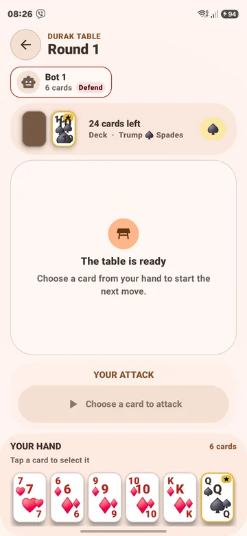
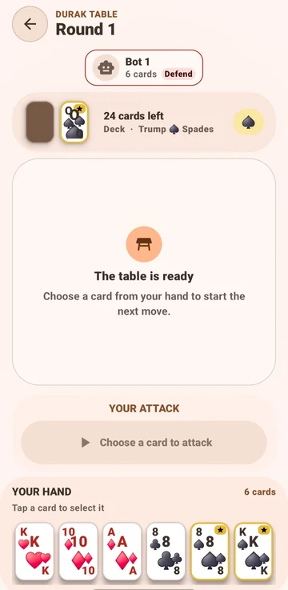
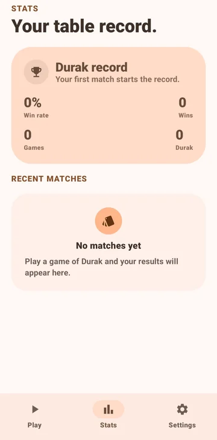

# Card Game Hub

Card Game Hub is a native Android collection built with **Kotlin**, **Jetpack Compose**, **Material 3 Expressive**, and **Room**. Five titles are playable offline: Durak against local bots, plus Crazy Eights, War, Go Fish, and Blackjack as local pass-and-play sessions. Durak match history and appearance settings are stored on-device; the four additional game sessions are not yet included in Durak's persistent statistics.

> **Version 1.1.8 · Build 10**
>
> Current version declared by the Android Gradle configuration.

## Previous-build screenshots (version 1.1.3)

The images below are historical reference captures from version 1.1.3. The home screen in this build returns to the earlier featured-game layout; the gameplay and settings continue to evolve.

| Home | Game table |
|---|---|
|  |  |

| Stats |
|---|
|  |

## Features

| Area | Available in the current build |
|---|---|
| **Offline play** | Five playable titles: Durak plus Crazy Eights, War, Go Fish, and Blackjack; no account or server is required. |
| **Local opponents** | Durak supports classic offline bots with Beginner, Standard, and Expert difficulty. The other four games use pass-and-play on one device. |
| **Match configuration** | Choose 2–4 players, a supported 24-, 36-, or 52-card deck, the Standard (Throw-in/Podkidnoy) ruleset, and bot difficulty. Transfer is shown as unavailable until its separate rules are implemented. Four-player tables require at least 36 cards so the trump remains in the draw pile. |
| **Game-specific rules** | Durak validates attacks, defenses, throw-ins, table-taking, turn progression, and match endings. Separate tested engines power Crazy Eights, War, Go Fish, and Blackjack. |
| **Responsive table** | The opponent rail and central attack/defense pairs adapt to the available screen width. Cards reduce to a readable minimum and the table automatically scrolls when the final pairs cannot fit at once. |
| **Material 3 Expressive UI** | Uses a shared forest-and-ivory theme, semantic color roles, a restrained game-library hero, native Material navigation and setup sheet, expressive typography, and a focused felt-inspired game table. |
| **Visual styles** | Switch between Material 3 Expressive and an original One UI-inspired treatment built from standard Android/Compose components; the choice is saved locally and applied across the app. |
| **Selective blur** | Material 3 Expressive adds subtle blurred ambient color behind the home content; gameplay text, cards, and controls stay crisp. Older Android versions retain a soft gradient fallback. |
| **Adaptive color** | Uses Android dynamic color on Android 12 and newer, with warm Material fallback palettes on earlier supported versions. |
| **Navigation appearance** | Choose the standard labeled Material 3 navigation bar or the compact navigation dock from Settings. The choice is saved locally and applied immediately. |
| **Statistics and history** | Completed Durak matches and aggregate statistics are stored locally through Room. The four additional local sessions do not update Durak statistics. |
| **Resume a match** | In-progress Durak matches are saved locally after each transition and restored when the app is reopened. Pass-and-play sessions are currently in-memory only. |
| **Safe database upgrades** | Room schema snapshots are exported and explicit migrations preserve existing statistics and match history. |
| **Privacy by default** | The current game is local-only. No sign-in, analytics service, remote matchmaking, or network permission is required for gameplay. |

## Gameplay

Durak remains the featured game: configure a table, deal, attack, defend or take the table, finish the round, replenish hands, and continue until its end state. The game library also launches Crazy Eights, War, Go Fish, and Blackjack as local pass-and-play sessions with player-count selection. Their rules engines are separate from Compose and covered by unit tests; those sessions are not persisted or added to Durak's match history. Hearts and Spades remain marked as planned, not playable.

The playable ruleset is **Standard (Podkidnoy/Throw-in) Durak**: the principal attacker leads, and eligible non-defenders may join with cards matching ranks already on the table. The total attack is limited to six cards or the defender's hand size at the start of the bout, whichever is lower. Only players who joined the attack replenish before the defender. The mode picker no longer presents **Classic** as a separate duplicate choice; **Transfer** is a distinct variant and is clearly marked unavailable until its rules are implemented. See [Podkidnoy Durak rules](https://www.pagat.com/beating/podkidnoy_durak.html) for the reference rules used here.

## Design and interaction

Material 3 Expressive remains the default visual system. Design Customization also offers a One UI-inspired alternative using standard Compose/Material components rather than Samsung SDK components. Compact windows use a Material navigation bar; expanded windows use a Material navigation rail, with the preference controlling whether destination labels are visible. Custom card artwork and table felt are Compose-rendered game visuals; routine navigation, selections, buttons, sheets, lists, and prompts use Material 3 components. In M3 Expressive, two low-contrast blurred ambient glows sit behind the home content only; no actionable or readable element is blurred.

Color roles are paired semantically across the fallback and dynamic themes, and the fallback palette is covered by contrast regression tests. Typography and shapes are centrally themed rather than reinvented per screen. Match turn and action state remain visibly labeled; decorative card-fan artwork is hidden from accessibility services, while actionable Material controls retain their standard semantics and touch targets.

## Technical architecture

| Module or package | Responsibility |
|---|---|
| `app/src/main/java/com/example/durak/game` | Deterministic Durak state machine with immutable player/hand snapshots, legal move validation, turn sequencing, and bot-turn recovery. |
| `app/src/main/java/com/example/durak/ai` | Offline bot decision policies for attack, defense, passing, and taking the table. |
| `app/src/main/java/com/example/durak/model` | Cards, suits, players, game modes, difficulties, and validated match configuration. |
| `app/src/main/java/com/example/cardgames` | Independent local rules engines and catalog for Crazy Eights, War, Go Fish, and Blackjack. |
| `app/src/main/java/com/example/ui/screens` | Home hub, inline match settings, game table, statistics, history, and settings screens. |
| `app/src/main/java/com/example/ui/viewmodel` | State orchestration between the game engine, Compose UI, and persisted match results. |
| `app/src/main/java/com/example/ui/theme` | Dynamic color, fallback palettes, typography, shapes, and Material 3 theme setup. |
| `app/src/main/java/com/example/data` | Room database entities, exported schemas, explicit migrations, resumable match persistence, history, and transactional statistics. |

The app deliberately keeps future product seams explicit. Additional card games can provide their own rules engine and screen, while online multiplayer can later be introduced behind a dedicated authenticated match service. No future feature is represented as an active online control in the first release.

## Build locally

The repository includes a Gradle wrapper. Use Android Studio or the Android command-line tools with the Android SDK installed, and use the Java toolchain configured by the project.

```bash
./gradlew :app:assembleDebug
```

The debug APK is written to:

```text
app/build/outputs/apk/debug/app-debug.apk
```

To run local tests and build an optimized release APK:

```bash
./gradlew clean :app:testDebugUnitTest :app:assembleDebugAndroidTest :app:assembleRelease --no-daemon --console=plain
```

The release artifact is written to the standard release output directory; Gradle names it `app-release.apk` when signed and `app-release-unsigned.apk` when no private signing values are configured:

```text
app/build/outputs/apk/release/app-release.apk
```

## Tests

Run local unit tests and compile the Compose instrumentation tests with:

```bash
./gradlew :app:testDebugUnitTest :app:assembleDebugAndroidTest
```

Run Compose UI tests on a connected Android device or emulator with:

```bash
./gradlew :app:connectedDebugAndroidTest
```

Run the Durak engine regression suite directly with:

```bash
./gradlew :app:testDebugUnitTest --tests 'com.example.durak.game.DurakEngineTest'
```

The regression coverage includes immutable old-snapshot checks, card hierarchy, legal and illegal defenses, Transfer Durak rules and bot decisions, throw-in behavior, participant-only replenishment, match endings, active-match JSON round trips, and a version 1-to-2 Room migration preserving statistics and history. Compose UI tests cover the Play-arrow menu, all playable launches, match setup, and a full human-played match. GitHub Actions runs unit tests, builds debug APKs, and runs the UI suite on an Android emulator.

## Release and R8

The current app configuration declares `versionName = "1.1.8"` and `versionCode = 10`. Release builds keep **R8 code shrinking, optimization, obfuscation, and resource shrinking enabled**.

The in-app updater compares the installed build with GitHub's latest **published release**; it does not treat untagged commits as downloadable APK updates. If the installed build is ahead of the latest release, About reports both versions and links directly to the release page.

R8 is a build-time optimizer; it is not a runtime feature that older Android devices need to support. The APK runtime floor is defined by `minSdk = 24` (Android 7.0). Therefore, using R8 does not by itself make the app incompatible with older supported Android versions. Release signing is now kept separate from the debug key. To sign a production release, supply `ANDROID_KEYSTORE_PATH`, `ANDROID_KEYSTORE_PASSWORD`, `ANDROID_KEY_ALIAS`, and `ANDROID_KEY_PASSWORD` in the build environment; leave all unset for an unsigned release build. Keep the private keystore and values out of source control. A debug APK is for testing and is signed with the standard debug key.

### Optional external AI

Google's [Gemini Developer API](https://ai.google.dev/gemini-api/docs) is a reasonable provider for a future optional AI coach or opponent. The current app keeps gameplay offline and does **not** call a remote model. Never embed an API key in `BuildConfig`, resources, or the APK; Google recommends a server-side proxy because client-side keys can be extracted ([key security guidance](https://ai.google.dev/gemini-api/docs/api-key)). A production integration should keep credentials on a backend, authenticate app requests, validate a minimal game-state payload, enforce rate/usage limits, and gracefully fall back to the local bot. API use may incur charges depending on the provider's current tier and usage ([Gemini pricing](https://ai.google.dev/gemini-api/docs/pricing)).

For more information, see the official Android documentation on [code shrinking](https://developer.android.com/studio/build/shrink-code) and [Java 8+ API desugaring](https://developer.android.com/studio/write/java8-support).

## Project status

Card Game Hub is an offline-first card-game platform with five playable titles. Durak has bots, persistent match results, and validated setup; Crazy Eights, War, Go Fish, and Blackjack are pass-and-play sessions. Hearts/Spades remain planned, and real nearby/online multiplayer is not included.

## License

No open-source license has been selected for this repository yet. Until a license is added, all rights are reserved by the repository owner.
